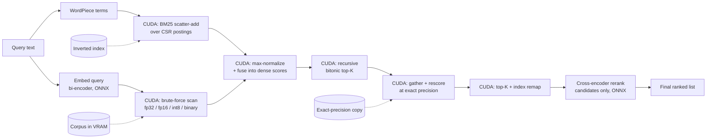

# Zero-Copy GPU Vector Search & Re-Ranking Engine

A C++/CUDA retrieval engine that holds a document corpus in VRAM at your choice of four
storage precisions, scans it with hand-written CUDA kernels, optionally fuses a GPU BM25
pass over an inverted index, selects the top-K with a recursive bitonic network, re-scores
the survivors at exact precision **without the candidate set ever leaving the device**, and
reranks with a cross-encoder. Exposed to Python via `pybind11`.

This is **exact** brute-force search — no approximate index. That scope is deliberate: a
correct GPU scan that you can measure against cuBLAS and against a CPU baseline is a
finishable, honest artifact. Everything added on top makes it a *system* rather than a demo.

**No training anywhere.** Every model is a downloaded checkpoint exported to ONNX; every
quantized corpus is a deterministic transform of the float32 one; the dataset comes from the
Hugging Face Hub. One command fetches the lot.

```bash
bash scripts/download_all.sh   # ONNX Runtime + Python deps + models + corpus + indexes
bash scripts/build.sh          # compile
bash scripts/verify.sh         # prove it works
```

Full walkthroughs: [DOWNLOAD](docs/DOWNLOAD.md) → [RUN](docs/RUN.md) → [VERIFY](docs/VERIFY.md)
→ [BENCHMARKS](docs/BENCHMARKS.md). To understand every line of it,
[LEARNING](docs/LEARNING.md) maps each concept to the exact file it explains.

## Pipeline



Everything from the scan through the index remap is device-resident and can be replayed from
a single captured **CUDA graph**. Only the final `k` indices and scores cross to the host.

## The zero-copy claim, precisely

What stays on the device:

- **Corpus embeddings** load into VRAM once at startup and are never re-uploaded per query.
- The **scan** produces a `[batch, N]` score matrix in device memory.
- The **BM25 stage** scatter-adds into a `[batch, N]` lexical vector, reduces its maximum,
  and fuses it into the dense scores — three kernels, no host round trip.
- The **top-K** consumes those `N` scores and emits `k` indices + scores in device memory.
  Intermediate candidate sets ping-pong between two device scratch buffers.
- The **rescore stage** reads the top-K index buffer *directly* as a gather list, re-scores
  those rows against a higher-precision copy of the corpus, selects again, and remaps local
  positions back to corpus indices. The coarse-to-exact hand-off is a device pointer.

What crosses the boundary, and why it is small:

- The query embedding (384 floats per query) is uploaded per request — negligible.
- After selection, **only the `k` indices and scores** (a few hundred bytes) are copied back,
  through **page-locked** staging, solely to look up passage text for the cross-encoder.
  This is the single explicit transfer, in `Searcher::copyResultToHost`.

What a naive stack does instead: copies the entire `N`-element score array to the host and
argsorts on the CPU; and for quantized retrieval, copies candidate ids back so the host can
re-fetch full-precision vectors and rescore. This engine deletes both round trips.

Honest caveat: passage *text* lives on the host, so the cross-encoder tokenizes on the CPU
and then runs on the GPU (ONNX Runtime CUDA EP). The transfers eliminated are the score
vector and the candidate **selection/rescore** round trips, not tokenization. Precomputing
device-resident token-id rows and binding them with ONNX IO binding would remove even the
index→host hop; that is out of scope.

## Features

| Feature | Where | One-liner |
| --- | --- | --- |
| Four storage precisions | `ScalarType`, `similarity.cu` | fp32 / fp16 / **int8** / **binary** — up to 32× less VRAM and bandwidth |
| On-device rescoring | `rescore.cu`, `Searcher` | Coarse candidates are re-scored exactly without touching the host |
| Batched multi-query scan | `similarity.cu` | One corpus row read serves 8 queries — the scan stops being purely bandwidth-bound |
| Recursive top-K merge | `topk.cu` | Merge passes recurse, so corpus size is no longer capped |
| CUDA graph replay | `Searcher` | The whole device pipeline replays from one instantiated graph |
| Hybrid BM25 + dense | `lexical.cu` | GPU scatter-add over a CSR inverted index, fused into the dense scores on-device |
| cuBLAS reference backend | `cublas_similarity.cpp` | The vendor GEMM, for benchmarking the hand-written kernel honestly |
| Metrics + filtering | `Metric`, device mask | Cosine / dot / L2, and an allow-mask evaluated inside the scan |
| Incremental indexing | `EmbeddingStore::append` | Embed and append to the live VRAM index, quantizing on the device |
| Stage timing + NVTX | CUDA events, `nvtx.hpp` | Per-stage latency through the API; Nsight ranges behind a build flag |
| HTTP service | `zcgvs_tools.service` | `/search`, `/search/batch`, `/retrieve`, `/documents`, `/stats` |
| Kernel roofline bench | `apps/bench_kernels.cu` | GB/s vs theoretical peak, on synthetic data — no artifacts needed |

Full details and API in [`docs/FEATURES.md`](docs/FEATURES.md).

## Repository layout

```text
include/zcgvs/          public headers, one directory per module
  core/                 CUDA RAII (device buffer, pinned buffer, stream, errors, device info)
  data/                 on-disk formats, VRAM embedding store, corpus metadata, lexical index
  cuda/                 kernel launchers + device primitives (reduction, bitonic, decode)
  search/               device-resident search orchestration, params, results
  text/                 BERT WordPiece tokenizer
  onnx/                 ONNX Runtime session wrapper (CUDA execution provider)
  embed/                bi-encoder query embedder (interface + ONNX impl)
  rerank/               cross-encoder reranker (interface + ONNX impl + factory)
  engine/               top-level engine, config, options, stats, result types
src/                    implementations mirroring include/
bindings/python/        pybind11 module (zcgvs_engine)
apps/                   C++ CLI + synthetic kernel benchmark
tests/cpp/              eight CUDA correctness harnesses vs CPU references
tests/python/           wire-format round-trip tests (NumPy only, no GPU)
python/zcgvs_tools/     offline tooling: export, embed, quantize, lexical index, config, service
python/benchmarks/      end-to-end latency + retrieval-quality evaluation
scripts/                download + build + verify + demo + benchmark automation
configs/                example engine configs, one per variant
docs/                   the documentation set
```

## The CUDA kernels

**Brute-force scan** (`src/cuda/similarity.cu`). One block computes one document. The block
stages up to `kQueryTile = 8` query vectors in shared memory, each thread strides over the
embedding dimension (consecutive threads read consecutive addresses — coalesced), and each
loaded corpus element is reused across the whole query tile before being discarded. A
warp-shuffle + shared-memory reduction then folds the partials, once per query. This is
PMPP's reduction pattern with an outer-product-style tile on top: batching turns a pure
bandwidth problem into one with real reuse.

The kernel is templated on the storage type, converting to FP32 in registers:

- **fp32 / fp16** — direct load and widen.
- **int8** — dequantized with a matrix-wide scale carried in the file header. Asymmetric:
  the query stays FP32, so only the corpus side loses precision.
- **binary** — a separate kernel entirely: query and corpus are packed to one sign bit per
  dimension and compared with `__popc(a ^ b)`, mapped to a cosine-like score in [-1, 1].

All of them honour the metric selector and the optional device allow-mask in one code path.

**Top-K selection** (`src/cuda/topk.cu`). Selection is much harder to parallelize than a dot
product: the answer depends on a global ordering. Two kinds of pass, recursing:

1. *Local pass* — each block loads a 1024-element tile of scores (padding with `-inf`),
   bitonically sorts it in shared memory, and writes its top-`k` to scratch.
2. *Merge passes* — blocks load 4096-element tiles of the surviving candidates, sort, and
   emit top-`k` each, ping-ponging between two scratch buffers until one block remains.

Because a merge tile is 4096 and `k ≤ 1024`, every merge pass shrinks the candidate set by at
least 4×, so the recursion provably terminates. That removes the fixed candidate cap the
single-pass version had; corpus size is now bounded only by VRAM.

**Rescore** (`src/cuda/rescore.cu`). One block per candidate, reading the index straight out
of the top-K output buffer, scoring against the exact-precision store, then a second top-K
and a remap kernel that turns candidate-set positions back into corpus indices.

**BM25** (`src/cuda/lexical.cu`). One block per query term, threads striding over that term's
postings, `atomicAdd` into the score vector. All BM25 arithmetic — idf, term-frequency
saturation, length normalization — is precomputed into the posting weights offline, so the
device does a pure scatter-add. Then a block-reduced `atomicMax` for normalization and an
element-wise fuse.

Every kernel is checked against a CPU reference (`tests/cpp/`), including the exact
quantization and bit-packing conventions.

## Building

Dependencies:

- CUDA Toolkit 12.x (compute capability 7.0+); cuBLAS and NVTX ship with it
- ONNX Runtime GPU build — `scripts/download_onnxruntime.sh` fetches it
- `pybind11`, CMake ≥ 3.24, a C++17 host compiler

```bash
cmake -B build -S . \
  -DONNXRUNTIME_ROOT=/path/to/onnxruntime-linux-x64-gpu \
  -Dpybind11_DIR=$(python -m pybind11 --cmakedir)
cmake --build build -j
ctest --test-dir build
```

Options: `-DZCGVS_ENABLE_NVTX=ON` for Nsight ranges, `-DZCGVS_BUILD_APPS=OFF`,
`-DZCGVS_BUILD_TESTS=OFF`, `-DZCGVS_BUILD_PYTHON=OFF`.

Artifacts: `build/bindings/zcgvs_engine*.so`, `build/apps/zcgvs_search_cli`,
`build/apps/zcgvs_bench_kernels`, `build/tests/zcgvs_test_*`. At runtime the ONNX Runtime
shared library must be on the loader path (`LD_LIBRARY_PATH=$ONNXRUNTIME_ROOT/lib`).

## Usage

```python
from zcgvs_tools.config import build_engine

engine = build_engine("configs/scifact_binary_rescore.json")

options = engine.default_options()
options.top_k, options.candidates = 10, 100

response = engine.search_with("what causes type 2 diabetes", options)
for hit in response.hits:
    print(hit.doc_id, hit.rerank_score, hit.text[:80])
print(response.timing.search_gpu_ms, response.timing.total_ms, response.timing.graph_replay)

# one device pass for many queries
batch = engine.search_batch(["query one", "query two", "query three"], options)

# hybrid lexical + dense, if the config carries an inverted index
options.hybrid = True
options.dense_weight = 0.7
engine.search_with("crispr gene editing", options)
```

C++ CLI and the HTTP service are documented in [`docs/RUN.md`](docs/RUN.md); the full API
surface is in [`docs/API.md`](docs/API.md).

## Reranker runtime: why ONNX Runtime

The obvious C++ path for the cross-encoder is "export to TorchScript, load with LibTorch."
**TorchScript is deprecated as of PyTorch 2.10.** It still loads, but this engine takes the
more future-proof, vendor-neutral route: export to ONNX (`optimum` does it in one line) and
run with ONNX Runtime's C++ API on the CUDA execution provider.

The reranker sits behind the abstract `Reranker` interface, so a LibTorch backend could be
added as a second implementation and selected via `EngineConfig::reranker_backend` without
touching the engine or the kernels — and the kernels are the real content either way.

## Benchmarking

Three layers, all reproducible with `bash scripts/bench_all.sh`:

1. **Kernel roofline** — `zcgvs_bench_kernels` on synthetic data: achieved GB/s per storage
   precision against the device's theoretical peak, the custom kernel against `cublasSgemv`,
   top-K cost at several widths, and batch/graph throughput. Needs no artifacts.
2. **End-to-end latency** — the engine against a pure-Python `sentence-transformers` +
   `CrossEncoder` baseline over the same corpus, models and queries, plus a sweep over batch
   size and CUDA graphs.
3. **Retrieval quality** — Recall@k, nDCG@10 and GPU/CPU overlap on BEIR qrels, evaluated
   across the whole storage ladder so the accuracy cost of quantization and the accuracy
   recovered by rescoring are both visible.

Report what you measure. "Here is the transfer I removed, here is its measured effect, and
here is what it costs in recall" is a much stronger claim than a round speedup multiple.
[`docs/BENCHMARKS.md`](docs/BENCHMARKS.md) has the tables to fill in.

## Definition of done

- [x] Loads a real BEIR corpus into VRAM and answers text queries end-to-end
- [x] Scan, top-K, rescore, BM25 and fusion are hand-written CUDA kernels, each checked
      against a CPU reference
- [x] Candidate indices stay on-device between search, rescore and rerank; the only host
      transfer is the explicit pinned `copyResultToHost`
- [x] Four storage precisions down to 1 bit per dimension, with an exact-precision rescore
      stage to buy the accuracy back
- [x] The device pipeline is capturable and replayable as a CUDA graph
- [x] The hand-written kernel can be benchmarked against cuBLAS in the same harness
- [x] `import zcgvs_engine` works from Python via pybind11
- [x] Architecture, zero-copy accounting, reranker-runtime choice, wire formats and
      benchmark methodology are all documented

## Limitations

- Exact brute-force search only; no approximate index (HNSW/IVF) — deliberate scope.
- `k` and the rescore width are capped at 1024 by the shared-memory bitonic network.
- The cuBLAS backend covers float32 inner-product metrics without a mask; anything else
  falls back to the custom kernel automatically.
- CUDA graph capture covers the custom-kernel path; the cuBLAS path always launches directly.
- Incremental `add_documents` is refused while a rescore store or lexical index is attached,
  since those artifacts are built offline and would go stale.
- The C++ tokenizer implements BERT uncased basic + WordPiece tokenization; it does not do
  Unicode accent stripping or CJK segmentation (adequate for the English BEIR sets).
- Binary storage forces Hamming scoring; the metric selector does not apply to it.

See [`docs/ARCHITECTURE.md`](docs/ARCHITECTURE.md) for the data-flow and device-residency
deep dive, and [`docs/FORMATS.md`](docs/FORMATS.md) for the byte-level wire specs.
