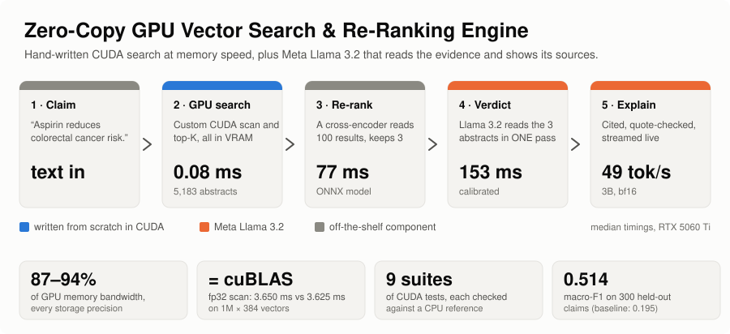
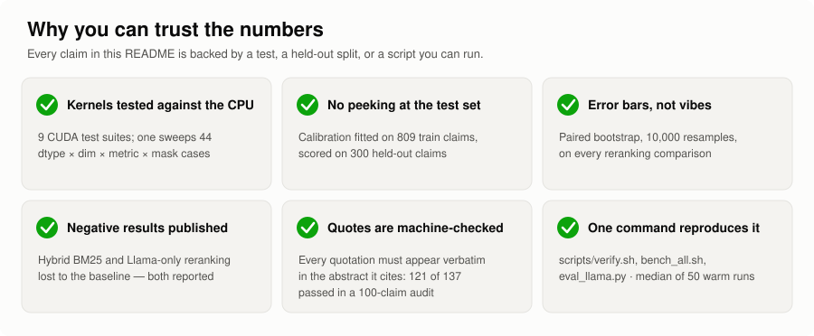
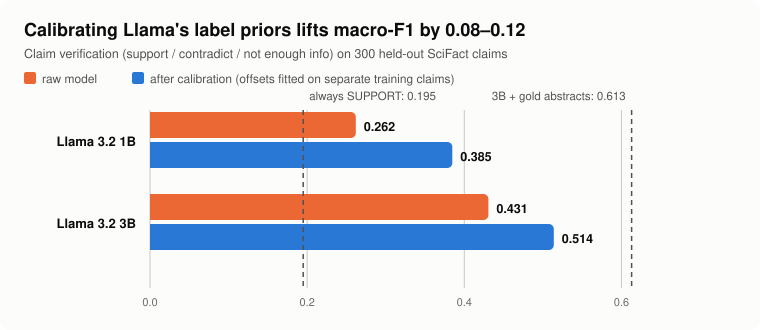
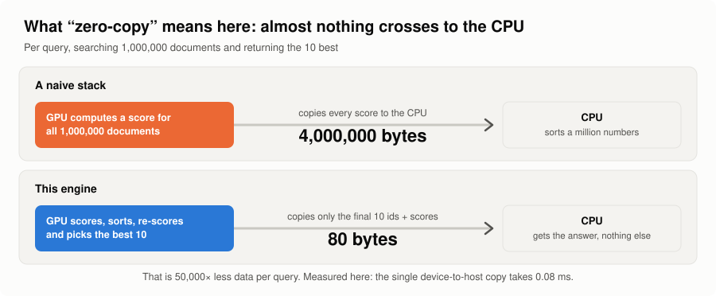

<p align="center">
  
</p>

<p align="center">
  
  
  
  
  
</p>

# Zero-Copy GPU Vector Search & Re-Ranking Engine

**Type a scientific claim. Get a verdict, a confidence, and an explanation whose quotes are checked
against the source papers — in about a quarter of a second to the verdict.**

---

## In plain English

You give it a claim, for example *"Bariatric surgery has a positive impact on mental health."*

1. It **searches 5,183 research abstracts** and picks the few that matter most — in under a tenth
   of a millisecond.
2. Meta's **Llama 3.2** reads those abstracts and answers **Supported**, **Contradicted** or
   **Not enough info**, with a confidence percentage.
3. It **explains itself in plain English, quoting its sources** — and every quotation is
   automatically checked against the paper it claims to come from.

Think of it as a very fast librarian and a careful reader. The **librarian** is custom GPU code,
written from scratch in CUDA, that finds the right papers at close to the physical speed limit
of the graphics card's memory. The **reader** is Llama, which decides what those papers say about
your claim.

> **Why "zero-copy"?** A normal GPU search copies a score for every document back to the CPU
> to sort them. Here the sorting and re-scoring happen *inside* the GPU, and only the final ten
> answers travel back — [50,000× less data](#how-it-works).

---

## See it work

Real output from `python/examples/fact_check.py` with Llama 3.2 3B (the timing table is
collapsed to one line per claim). Claims are illustrative; aggregate accuracy is in
[the numbers](#the-headline-numbers).

```text
claim  Bariatric surgery has a positive impact on mental health.

evidence
  [1] Mental Health Conditions Among Patients Seeking and Undergoing Bariatric …
  [2] Psychological Outcome 4 Years after Restrictive Bariatric Surgery
  [3] Preoperative Predictors of Weight Loss Following Bariatric Surgery: Syste…

verdict SUPPORT (99.7% confidence)
  SUPPORT          ████████████████████████  99.7%
  CONTRADICT       ░░░░░░░░░░░░░░░░░░░░░░░░   0.2%
  NOT ENOUGH INFO  ░░░░░░░░░░░░░░░░░░░░░░░░   0.1%

why  The evidence supports the claim that bariatric surgery has a positive impact on mental
     health. The abstracts suggest that bariatric surgery is associated with significant
     improvements in depressive symptoms, physical dimension of quality of life, and self-
     esteem, with peak improvements 1 year after surgery, as stated in "...Statistical analysis
     revealed significant improvements in depressive symptoms, physical dimension of quality of
     life, and self-esteem with peak improvements 1 year after surgery." [2]. Additionally, the
     study found that "significant correlations between weight loss and improvements in
     depression, physical aspects of HRQOL (T2, T3, and T4), and self-esteem (T3) were
     observed." [2].

quote check (is each quoted passage in the cited abstract?)
  ✓ verified  [2]  “...Statistical analysis revealed significant improvements in depressive symptoms, physical…”
  ✓ verified  [2]  “significant correlations between weight loss and improvements in depression, physical aspe…”
timing  GPU search 0.08 ms · verdict 157 ms · explanation streams at 49 tok/s

claim  Mitochondria are uninvolved in apoptosis.

evidence
  [1] Mitochondria: Dynamic Organelles in Disease, Aging, and Development
  [2] Bioenergetic aspects of apoptosis, necrosis and mitoptosis
  [3] Bax translocation and mitochondrial fragmentation induced by Helicobacter…

verdict CONTRADICT (65.9% confidence)
  SUPPORT          ██████░░░░░░░░░░░░░░░░░░  25.5%
  CONTRADICT       ████████████████░░░░░░░░  65.9%
  NOT ENOUGH INFO  ██░░░░░░░░░░░░░░░░░░░░░░   8.6%

why  The claim that mitochondria are uninvolved in apoptosis is contradicted by the evidence
     presented in the abstracts. For example, abstract [2] states that "ATP and rather often
     mitochondrial hyperpolarization (i.e. an increase in membrane potential, ΔΨ) are required
     for certain steps of apoptosis and necrosis." This suggests that mitochondria play a role
     in apoptosis, contradicting the claim. Additionally, abstract [3] mentions "Bax
     translocation and mitochondrial fragmentation" which further supports the involvement of
     mitochondria in apoptosis.

quote check (is each quoted passage in the cited abstract?)
  ✓ verified  in [2]  “ATP and rather often mitochondrial hyperpolarization (i.e. an increase in membrane potenti…”
  ✓ verified  in [3]  “Bax translocation and mitochondrial fragmentation”
timing  GPU search 0.08 ms · verdict 124 ms · explanation streams at 50 tok/s

claim  Statins increase the risk of developing type 2 diabetes.

evidence
  [1] Mechanisms linking obesity to insulin resistance and type 2 diabetes
  [2] Biomarkers of endothelial dysfunction and risk of type 2 diabetes mellitus
  [3] The prevention of type 2 diabetes

verdict NOT ENOUGH INFO (88.6% confidence)
  SUPPORT          ░░░░░░░░░░░░░░░░░░░░░░░░   0.1%
  CONTRADICT       ███░░░░░░░░░░░░░░░░░░░░░  11.3%
  NOT ENOUGH INFO  █████████████████████░░░  88.6%

why  The verdict is NOT ENOUGH INFO because the abstracts do not provide direct evidence linking
     statins to the development of type 2 diabetes. The abstracts focus on the relationship
     between obesity, insulin resistance, endothelial dysfunction, and type 2 diabetes, but do
     not mention statins. For example, "Abnormalities in β-cell function are therefore critical
     in defining the risk and development of type 2 diabetes." [1]

quote check (is each quoted passage in the cited abstract?)
  ✓ verified  [1]  “Abnormalities in β-cell function are therefore critical in defining the risk and developme…”
timing  GPU search 0.07 ms · verdict 121 ms · explanation streams at 50 tok/s
```

---

## The headline numbers

All measured on one RTX 5060 Ti (16 GB), median of repeated runs after warmup, and reproduced by
the scripts in this repo.

| What | Result | In plain English |
| --- | --- | --- |
| Search speed, 1M documents, int8 | **0.959 ms** · 89% of memory bandwidth | Reads data about as fast as the hardware physically allows |
| Same kernel, float32, vs NVIDIA's own cuBLAS | **3.650 ms vs 3.625 ms** | Matches NVIDIA's library — which cannot do int8, binary, filtering or L2 at all |
| Search, SciFact (5,183 abstracts) | **0.08 ms** per query | The search is a rounding error; the models dominate the wait |
| Smaller index, same accuracy | **4× less memory**, nDCG@10 **0.6807 → 0.6807** | int8 compression cost nothing measurable |
| Fact-check verdict (3 labels) | **55% accuracy · macro-F1 0.514** | Always guessing "Supported" scores 41% / 0.195 |
| Time to a verdict | **235 ms** | Retrieve, re-rank, and classify in one forward pass |
| Quotes in explanations | **88% (121 of 137)** are verbatim in the cited abstract | The rest are flagged on screen, not silently shown |
| Rewrite of the search kernel | up to **44× faster** than my first version | First version: correct, but 5–8 ms at every precision |

<p align="center">
  
</p>

---

## Why you can trust the numbers

<p align="center">
  
</p>

Five things the measurements taught me, each documented rather than smoothed over:

- **My first kernel was correct and still slow.** It passed every test but ran all four storage
  precisions at the same speed. Profiling showed every block re-loaded the queries; the fix
  (a persistent kernel) is the chart above.
- **Llama needed calibration.** Raw, the 1B model *never* predicted "Contradicted". Three offsets
  fitted on training claims (never the test claims) fixed that: macro-F1 +0.12 (1B), +0.08 (3B).
- **A precision bug hid in my first scorer.** bf16 logits tied most candidates; computing the
  answer rows in float32 fixed it.
- **Some ideas lost, and are reported as losses.** Hybrid keyword search was slightly *worse*
  than dense search on this dataset, and no Llama-only reranker beat the trained cross-encoder.
- **A promising gain isn't called a win.** Fusing Llama 1B with the cross-encoder scores +0.017
  nDCG@10, but the bootstrap interval [−0.002, +0.036] crosses zero, so it is reported as
  "promising, not proven".

<p align="center">
  
</p>

---

## How it works

<p align="center">
  
</p>

1. **Embed.** A small neural network turns your claim into 384 numbers that capture its meaning.
   Every abstract was converted the same way once, in advance, and lives in GPU memory.
2. **Search (CUDA, from scratch).** One GPU kernel compares your 384 numbers with every stored
   abstract. The stored data can be float32, float16, int8 or 1 bit per number — smaller means
   faster and cheaper, at a measured accuracy cost.
3. **Select (CUDA).** A recursive bitonic sorting network picks the best candidates, entirely
   on the GPU. A second kernel re-scores them at full precision without leaving GPU memory.
4. **Re-rank.** A cross-encoder reads the 100 best candidates alongside the claim and keeps the
   top 3.
5. **Judge (Llama 3.2).** Llama reads the claim and three abstracts **once** and the verdict is
   read straight from its output scores — no text generation, no parsing, a real probability.
   Then it writes the explanation, quoting abstracts as `[1]`–`[3]`, and each quote is checked.

<details>
<summary><b>Plain-English glossary</b></summary>

- **Embedding** — a list of numbers (here 384) that represents the meaning of a sentence.
- **VRAM** — the graphics card's own memory. Fast, but separate from the CPU's.
- **Memory bandwidth / roofline** — how fast the card can read its memory. Searching is limited
  by this, so "90% of peak" means almost no room left to optimize.
- **Quantization** — storing numbers with fewer bits (int8, 1 bit) to save memory and time.
- **Cross-encoder** — a slower, more accurate model that reads the claim and a passage together.
- **Macro-F1** — an accuracy score averaged over all three verdicts, so ignoring a rare one
  (e.g. "Contradicted") is punished.
- **Calibration** — correcting a model's habit of favoring one answer, using separate training data.
- **Bootstrap interval** — a range for how much a result could change if the test set were
  resampled; if it includes zero, the improvement isn't proven.

</details>

<details>
<summary><b>The CUDA kernels in more detail</b></summary>

**Scan** (`src/cuda/similarity.cu`) — persistent, warp per document. The grid is sized to exactly
fill the GPU (`cudaOccupancyMaxActiveBlocksPerMultiprocessor`); each resident block stages a tile
of 8 queries into shared memory once, then its warps stride over the corpus, reading rows in
128-bit loads (`float4`, 8 × `half`, 16 × `int8`) and finishing with a butterfly shuffle
reduction. Binary rows are only 48 bytes, so the Hamming kernel gives each *thread* a document
(`__popc` over `uint4` loads). It falls back to a scalar path when a row doesn't divide into
16-byte vectors. A 44-case test sweeps every combination against a CPU reference.

**Top-K** (`src/cuda/topk.cu`) — local bitonic sort of 1024-element tiles, then recursive 4096-
element merge passes that shrink the candidate set at least 4× each, so corpus size is bounded
only by VRAM. At k = 100 over 1M scores it takes 0.53 ms — now the largest remaining cost.

**Rescore** (`src/cuda/rescore.cu`) — reads candidate ids straight from the top-K output buffer
as a gather list; **BM25** (`src/cuda/lexical.cu`) — scatter-add over a CSR inverted index,
fused into the dense scores on-device. Full write-up: [`docs/ARCHITECTURE.md`](docs/ARCHITECTURE.md).

</details>

---

## What Llama does here

Four jobs, each evaluated separately in [`docs/LLAMA.md`](docs/LLAMA.md):

1. **Verdict** — one forward pass, logits computed in float32 from only the three label rows,
   then calibrated.
2. **Cited explanation** — streamed live; every quotation is machine-checked
   (`check_quotes`): in a 100-claim audit **121 of 137 quotations (88%) were verbatim in the abstract they cited**; 13 were not found word for word and 3 were credited to the wrong abstract, all flagged on screen. 70 of 100 explanations were fully verified; 14 contained no quotation to check.
3. **Zero-shot reranking** — query-likelihood and yes/no scoring, fused with the cross-encoder.
4. **Grounded Q&A** — answers only from retrieved abstracts, with `[n]` citations (`--ask`, `POST /ask`).
   A demonstration rather than a benchmarked result; use the 3B model.

---

## Try it

```bash
bash scripts/download_all.sh     # ONNX Runtime, Python deps, encoder + reranker, SciFact, indexes
bash scripts/download_llama.sh   # Llama 3.2 3B + 1B, plus the SciFact verdict labels
bash scripts/build.sh            # compile the CUDA/C++ engine and Python bindings
bash scripts/verify.sh           # 9 CUDA suites + end-to-end checks
bash scripts/run_factcheck.sh    # fact-check a claim
```

```bash
CLAIM="Statins increase the risk of type 2 diabetes." bash scripts/run_factcheck.sh
python python/examples/fact_check.py --llama models/llama/Llama-3.2-3B-Instruct \
    --ask "What links obesity to insulin resistance?"
python -m zcgvs_tools.service --config configs/scifact.json \
    --llama models/llama/Llama-3.2-3B-Instruct       # HTTP: /search, /verify, /ask, ...
bash scripts/bench_all.sh        # reproduce every performance number
```

Needs an NVIDIA GPU: Llama peaks at 6.8 GB (3B) or 3.4 GB (1B), plus the search index and ONNX models
(the whole 3B demo measured about 8.5 GB),
CUDA (tested on 13.3), CMake ≥ 3.24 and a C++17 compiler. The official `meta-llama/*` repos are gated; if
your Hugging Face account lacks access, the download falls back to an identical mirror of the same
weights, which the Llama 3.2 license permits.

```python
from zcgvs_tools.config import build_engine
from zcgvs_tools.factcheck import ClaimVerifier
from zcgvs_tools.llama import Llama

engine = build_engine("configs/scifact.json")
llama = Llama("models/llama/Llama-3.2-3B-Instruct")
verdict = ClaimVerifier(engine, llama).verify("Aspirin reduces colorectal cancer risk.")
print(verdict.label, verdict.probabilities, verdict.quotes_verified)
```

---

## What's inside

| | |
| --- | --- |
| `src/cuda/`, `include/zcgvs/` | The CUDA kernels and C++ engine (scan, top-K, rescore, BM25, CUDA graphs) |
| `python/zcgvs_tools/llama.py`, `factcheck.py` | Llama runtime, verifier, reranker, grounded Q&A, quote checker |
| `python/benchmarks/` | Retrieval quality, end-to-end latency, and the Llama evaluation |
| `tests/` | 9 CUDA suites against CPU references; Python tests for the logic |
| `scripts/` | Download, build, verify, benchmark and demo scripts; `make_figures.py` regenerates the README figures from the results files |
| `docs/` | [Architecture](docs/ARCHITECTURE.md) · [Benchmarks](docs/BENCHMARKS.md) · [Llama](docs/LLAMA.md) · [Features](docs/FEATURES.md) · [API](docs/API.md) · [Learning path](docs/LEARNING.md) |

Features beyond the headline: four storage precisions with on-device rescoring, batched multi-query
scans, CUDA-graph replay, hybrid BM25 + dense search, cosine/dot/L2 metrics, filtered search,
incremental indexing, NVTX profiling hooks, and a FastAPI service — all in
[`docs/FEATURES.md`](docs/FEATURES.md).

---

## Scope and honest limits

- **Exact search by design.** There is no approximate index (HNSW/IVF); correctness you can
  measure was the goal. The 1M-document numbers are synthetic kernel benchmarks; end-to-end
  quality is measured on SciFact (5,183 abstracts).
- **Small models, on purpose.** Llama 3.2 1B/3B are what fit beside the index on a 16 GB card.
  The verdict is claim-level, not per-abstract, and the calibration is fitted to SciFact.
- **Explanations are generated text.** The quote checker catches invented and misattributed
  quotations, not imperfect paraphrase — which is why the evidence is always printed beside the
  verdict.
- **Llama alone doesn't out-rank the trained cross-encoder**; its value is in fusion and in
  reading the evidence.
- **"Zero-copy" has a boundary.** Passage text lives on the CPU, so tokenization stays there;
  what is eliminated is the score-vector and candidate-selection round trips.

---

Llama 3.2 is licensed under the [Llama 3.2 Community License](https://www.llama.com/llama3_2/license/),
Copyright © Meta Platforms, Inc. All Rights Reserved.
