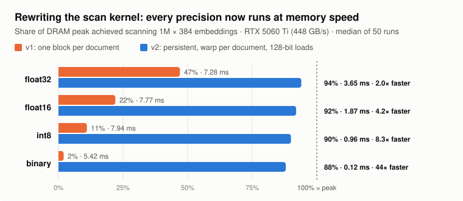
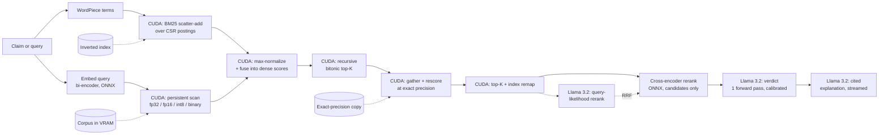

# Zero-Copy GPU Vector Search & Re-Ranking Engine — with Llama 3.2 fact-checking

**A scientific fact-checker on one consumer GPU.** Hand-written CUDA kernels scan an
embedding index at **88–94% of the card's memory bandwidth**, select and re-score candidates
without the candidate set ever leaving VRAM, and hand the evidence to **Meta Llama 3.2**, which
returns a calibrated SUPPORT / CONTRADICT / NOT ENOUGH INFO verdict in a single forward pass
and streams an explanation that cites the abstracts it used.


```text
$ python python/examples/fact_check.py --llama models/llama/Llama-3.2-3B-Instruct \
    --claim "Taking aspirin daily reduces the risk of colorectal cancer." \
    --claim "Statins increase the risk of developing type 2 diabetes."
index: 5183 abstracts, float32, 8.0 MB VRAM | model: Llama-3.2-3B-Instruct (6.4 GB bf16) | NVIDIA GeForce RTX 5060 Ti

claim  Taking aspirin daily reduces the risk of colorectal cancer.

evidence (CUDA scan → on-device top-K → cross-encoder)
  [1] doc 39903312  ce=+8.47  A randomized trial of aspirin to prevent colorectal adenomas in patients with previous colorectal cancer.. BAC…
  [2] doc 7613033  ce=+8.04  Aspirin in the chemoprevention of colorectal neoplasia: an overview.. Considerable evidence supports the effec…
  [3] doc 15648443  ce=+6.85  Long-term effect of aspirin on cancer risk in carriers of hereditary colorectal cancer: an analysis from the C…

verdict SUPPORT (99.6% confidence)
  SUPPORT          ████████████████████████  99.6%
  CONTRADICT       ░░░░░░░░░░░░░░░░░░░░░░░░   0.3%
  NOT ENOUGH INFO  ░░░░░░░░░░░░░░░░░░░░░░░░   0.1%

why  The evidence supports the claim that taking aspirin daily reduces the risk of colorectal cancer. According to abstract [1], patients who received aspirin had a 17% lower incidence of colorectal adenomas compared to those who received placebo (P=0.004), and abstract [2] reports a pooled analysis showing that daily aspirin treatment for about five years was associated with a 34% reduction in 20-year CRC mortality. These findings suggest a protective effect of aspirin against colorectal cancer, as reported in abstracts [1] and [2].

timing
  CUDA scan + top-K                 0.08 ms
  cross-encoder rerank             76.86 ms
  Llama verdict (1 forward)       150.15 ms
  Llama explanation              2468.72 ms
  Llama decode rate                49.33 tok/s
  end to end                     2699.63 ms

claim  Statins increase the risk of developing type 2 diabetes.

evidence (CUDA scan → on-device top-K → cross-encoder)
  [1] doc 120626  ce=+3.85  Mechanisms linking obesity to insulin resistance and type 2 diabetes. Obesity is associated with an increased …
  [2] doc 6176498  ce=+2.55  Biomarkers of endothelial dysfunction and risk of type 2 diabetes mellitus.. CONTEXT Endothelial dysfunction o…
  [3] doc 8708082  ce=+2.53  The prevention of type 2 diabetes. Type 2 diabetes mellitus (T2DM) affects more than 7% of adults in the US an…

verdict NOT ENOUGH INFO (88.6% confidence)
  SUPPORT          ░░░░░░░░░░░░░░░░░░░░░░░░   0.1%
  CONTRADICT       ███░░░░░░░░░░░░░░░░░░░░░  11.3%
  NOT ENOUGH INFO  █████████████████████░░░  88.6%

why  The verdict is NOT ENOUGH INFO because the provided abstracts do not directly address the relationship between statins and the risk of developing type 2 diabetes. Abstract [2] does mention endothelial dysfunction, which is a risk factor for type 2 diabetes, but it does not link statins to this risk. Abstract [3] discusses prevention strategies for type 2 diabetes, including lifestyle modification and medications, but does not mention statins.

timing
  CUDA scan + top-K                 0.08 ms
  cross-encoder rerank             75.81 ms
  Llama verdict (1 forward)       121.01 ms
  Llama explanation              1919.03 ms
  Llama decode rate                49.69 tok/s
  end to end                     2127.42 ms
```

Real output, unedited apart from omitting a third claim and three timing rows per claim. Two
things are worth noticing. The statin claim gets **NOT ENOUGH INFO**: SciFact contains no
statin–diabetes abstract, and the model says so instead of inventing one. And the aspirin explanation contains a real mistake:
abstract [1] reports adenomas in 17% of aspirin patients *versus 27%* on placebo, which the
model paraphrased as "a 17% lower incidence". The verdict and the [2] quote are correct. This
is why the verdict's probability comes from the classifier rather than the prose, and why the
evidence is always printed beside it.

Every number on this page was measured on the machine described in
[`docs/BENCHMARKS.md`](docs/BENCHMARKS.md) and is reproduced by a script in this repository.

## Results at a glance

| What | Measured | Against |
| --- | --- | --- |
| Scan 1M × 384 embeddings, **int8** | **0.957 ms** — 401 GB/s, 90% of DRAM peak | 7.94 ms before the kernel rewrite (**8.3×**) |
| Scan 1M × 384 embeddings, **binary** | **0.122 ms** — 88% of peak | 5.43 ms before (**44×**) |
| Scan 1M × 384, **float32** | 3.648 ms — 94% of peak | cuBLAS `sgemv`: 3.625 ms (a tie) |
| Retrieval on SciFact: query text → ranked candidates, no rerank | **0.73 ms/query**, 1 375 queries/s | — |
| int8 index vs float32, SciFact nDCG@10 | **0.6807 vs 0.6807** at 4× less VRAM | — |
| Rerank: cross-encoder fused with **Llama-3.2-1B** query likelihood (RRF) | nDCG@10 **0.6976** | cross-encoder alone 0.6807 — +0.017, but the 95% CI [−0.002, +0.036] crosses zero |
| Claim verification, Llama-3.2-3B, retrieved evidence | macro-F1 **0.514** | majority class 0.195 |
| Full fact-check: retrieve + verdict | **228 ms** to a calibrated verdict | explanation then streams at 50 tok/s |



## How Llama is used

Llama does four distinct jobs, and each one is measured separately in
[`docs/LLAMA.md`](docs/LLAMA.md):

1. **Verdict as a classifier.** The claim and the top-3 retrieved abstracts go through
   Llama-3.2-3B-Instruct **once**. The verdict is read from the logits of the three label
   tokens at the first answer position — computed in fp32 from the final hidden state, using
   only those three rows of the LM head. No decoding, no output parsing, a real probability.
   The label priors are **calibrated** (Zhao et al., 2021) on SciFact's *train* split and
   frozen before the test claims are touched.
2. **Cited explanation.** With the verdict fixed, Llama writes two or three sentences that
   quote the key finding and cite `[1]`–`[3]`, streamed token by token.
3. **Zero-shot reranking.** Two scoring rules: UPR-style query likelihood (Sachan et al.,
   2022), where Llama reads each candidate abstract and scores how probable it finds the actual
   claim, and a yes/no relevance judgement. Neither beats the trained cross-encoder on its
   own; fused with it by reciprocal-rank fusion, 1B query likelihood gives the best system
   measured (+0.017 nDCG@10), though a paired bootstrap says 300 queries cannot call that
   significant.
4. **Grounded Q&A.** `--ask` / `POST /ask` answers questions only from retrieved sources,
   with sentence-level citations.

Reported honestly, including what did not go the way I expected: the yes/no relevance prompt
*scrambles* the dense ranking with the 1B model (nDCG@10 0.25 vs 0.65) and only becomes
useful at 3B; query likelihood shows
the opposite trend (1B beats 3B); uncalibrated, the 1B model never predicts CONTRADICT; and an
early bf16 version of the scorer tied most candidates. Those findings, and the fixes, are in
[`docs/LLAMA.md`](docs/LLAMA.md).

## Pipeline



Everything from the scan through the index remap is device-resident and can be replayed from
a single captured **CUDA graph**. Only the final `k` indices and scores cross to the host.

## The kernel story

The first version of the scan was correct, passed every test, and was quietly slow: it
launched **one 256-thread block per document**, and every block re-staged the 8-query tile
(12 KB) into shared memory. At a million documents that is ~12 GB of redundant staging
traffic to scan a corpus of 0.05–1.5 GB — a fixed cost that swamped the actual data, so
float16, int8 and binary all ran at the same ~7.5 ms as float32. Quantization saved VRAM but
no time.

The rewrite (`src/cuda/similarity.cu`) is a **persistent** kernel: the grid is sized by
`cudaOccupancyMaxActiveBlocksPerMultiprocessor` to exactly fill the GPU, each resident block
stages the queries once, and its warps stride over the corpus — one **warp per document**,
reading rows in 128-bit vectors (`float4`, 8 × `half`, 16 × `int8`) and the queries as `float4`
from shared memory, then a butterfly shuffle reduction where lane *q* stores query *q*. Binary
rows are only 48 bytes, so the Hamming kernel gives each **thread** a document. Every
precision now runs within 6–12% of DRAM peak, and the fp32 path ties cuBLAS while also
handling fp16, int8, binary, L2 and allow-masks, which cuBLAS cannot.

A new harness, `tests/cpp/test_scan_paths.cu`, checks all 44 combinations of storage type ×
dimension (vectorized and scalar-fallback paths) × metric × mask × partial query tiles against
CPU references.

## The zero-copy claim, precisely

What stays on the device:

- **Corpus embeddings** load into VRAM once at startup and are never re-uploaded per query.
- The **scan** produces a `[batch, N]` score matrix in device memory.
- The **BM25 stage** scatter-adds into a `[batch, N]` lexical vector, reduces its maximum,
  and fuses it into the dense scores — three kernels, no host round trip.
- The **top-K** consumes those `N` scores and emits `k` indices + scores in device memory.
  Intermediate candidate sets ping-pong between two device scratch buffers.
- The **rescore stage** reads the top-K index buffer *directly* as a gather list, re-scores
  those rows against a higher-precision copy of the corpus, selects again, and remaps local
  positions back to corpus indices. The coarse-to-exact hand-off is a device pointer.

What crosses the boundary, and why it is small:

- The query embedding (384 floats per query) is uploaded per request — negligible.
- After selection, **only the `k` indices and scores** (a few hundred bytes) are copied back,
  through **page-locked** staging, solely to look up passage text for the cross-encoder and
  Llama. This is the single explicit transfer, in `Searcher::copyResultToHost` — measured at
  **0.076 ms**.

What a naive stack does instead: copies the entire `N`-element score array to the host and
argsorts on the CPU; and for quantized retrieval, copies candidate ids back so the host can
re-fetch full-precision vectors and rescore. This engine deletes both round trips.

Honest caveat: passage *text* lives on the host, so the cross-encoder and Llama tokenize on
the CPU and then run on the GPU. The transfers eliminated are the score vector and the
candidate **selection/rescore** round trips, not tokenization.

## Quickstart

```bash
bash scripts/download_all.sh     # ONNX Runtime + Python deps + encoder/reranker + SciFact + indexes
bash scripts/download_llama.sh   # Llama 3.2 3B + 1B Instruct, SciFact verdict labels
bash scripts/build.sh            # compile the CUDA/C++ engine and Python bindings
bash scripts/verify.sh           # 9 CUDA test suites + end-to-end checks
bash scripts/run_factcheck.sh    # fact-check a claim end to end
```

```bash
CLAIM="Statins increase the risk of type 2 diabetes." bash scripts/run_factcheck.sh
python python/examples/fact_check.py --llama models/llama/Llama-3.2-3B-Instruct \
    --ask "What links obesity to insulin resistance?"
python -m zcgvs_tools.service --config configs/scifact.json \
    --llama models/llama/Llama-3.2-3B-Instruct          # adds POST /verify and POST /ask
```

Full walkthroughs: [DOWNLOAD](docs/DOWNLOAD.md) → [RUN](docs/RUN.md) → [VERIFY](docs/VERIFY.md)
→ [BENCHMARKS](docs/BENCHMARKS.md) → [LLAMA](docs/LLAMA.md). To understand every line,
[LEARNING](docs/LEARNING.md) maps each concept to the exact file it explains.

**No training anywhere.** Every model is a downloaded checkpoint (ONNX exports of
`all-MiniLM-L6-v2` and `ms-marco-MiniLM-L6-v2`, and Llama 3.2 in bf16); every quantized corpus
is a deterministic transform of the float32 one; the only fitted parameters are Llama's three
calibration offsets, fitted on SciFact's train split.

## Features

| Feature | Where | One-liner |
| --- | --- | --- |
| Four storage precisions | `ScalarType`, `similarity.cu` | fp32 / fp16 / **int8** / **binary**, each at 88–94% of DRAM peak |
| On-device rescoring | `rescore.cu`, `Searcher` | Coarse candidates are re-scored exactly without touching the host |
| Batched multi-query scan | `similarity.cu` | One corpus row read serves 8 queries — 1 428 queries/s at 1M docs |
| Recursive top-K merge | `topk.cu` | Merge passes recurse, so corpus size is no longer capped |
| CUDA graph replay | `Searcher` | The whole device pipeline replays from one instantiated graph |
| Hybrid BM25 + dense | `lexical.cu` | GPU scatter-add over a CSR inverted index, fused into the dense scores on-device |
| cuBLAS reference backend | `cublas_similarity.cpp` | The vendor GEMV, for benchmarking the hand-written kernel honestly |
| Metrics + filtering | `Metric`, device mask | Cosine / dot / L2, and an allow-mask evaluated inside the scan |
| Incremental indexing | `EmbeddingStore::append` | Embed and append to the live VRAM index, quantizing on the device |
| Stage timing + NVTX | CUDA events, `nvtx.hpp` | Per-stage latency through the API; Nsight ranges behind a build flag |
| **Llama claim verifier** | `factcheck.ClaimVerifier` | Calibrated 3-way verdict in one forward pass + streamed, cited explanation |
| **Llama reranker** | `factcheck.LlamaReranker` | Zero-shot query-likelihood (UPR) or yes/no scoring, fused with the cross-encoder |
| **Grounded Q&A** | `factcheck.GroundedAnswerer` | Answers only from retrieved abstracts, with `[n]` citations |
| HTTP service | `zcgvs_tools.service` | `/search`, `/search/batch`, `/retrieve`, `/documents`, `/stats`, **`/verify`**, **`/ask`** |
| Kernel roofline bench | `apps/bench_kernels.cu` | GB/s vs theoretical peak, on synthetic data — no artifacts needed |

Full details and API in [`docs/FEATURES.md`](docs/FEATURES.md).

## Repository layout

```text
include/zcgvs/          public headers, one directory per module
  core/                 CUDA RAII (device buffer, pinned buffer, stream, errors, device info)
  data/                 on-disk formats, VRAM embedding store, corpus metadata, lexical index
  cuda/                 kernel launchers + device primitives (reduction, bitonic, decode)
  search/               device-resident search orchestration, params, results
  text/                 BERT WordPiece tokenizer
  onnx/                 ONNX Runtime session wrapper (CUDA execution provider)
  embed/                bi-encoder query embedder (interface + ONNX impl)
  rerank/               cross-encoder reranker (interface + ONNX impl + factory)
  engine/               top-level engine, config, options, stats, result types
src/                    implementations mirroring include/
bindings/python/        pybind11 module (zcgvs_engine)
apps/                   C++ CLI + synthetic kernel benchmark
tests/cpp/              nine CUDA correctness harnesses vs CPU references
tests/python/           wire-format round-trip tests (NumPy only, no GPU)
python/zcgvs_tools/     export, embed, quantize, lexical index, config, service,
                        llama.py (runtime), factcheck.py (verifier, reranker, Q&A),
                        scifact_claims.py (verdict labels)
python/benchmarks/      end-to-end latency, retrieval quality, Llama evaluation
python/examples/        quickstart.py, fact_check.py
configs/                engine configs, one per variant; calibration/ for Llama label offsets
docs/                   the documentation set; results/ holds raw evaluation JSON
scripts/                download + build + verify + demo + benchmark automation
```

## The CUDA kernels

**Scan** (`src/cuda/similarity.cu`) — persistent, warp per document, 128-bit loads, query
tile of 8 staged once per resident block. Templated on the storage type and vector width,
converting to FP32 in registers:

- **fp32 / fp16** — `float4` or 8 × `half` per lane, widened with `__half22float2`.
- **int8** — 16 values per lane, dequantized with a matrix-wide scale carried in the file
  header. Asymmetric: the query stays FP32, so only the corpus side loses precision.
- **binary** — a separate thread-per-document kernel: query and corpus are packed to one sign
  bit per dimension, compared with `__popc(a ^ b)` over `uint4` loads, mapped to a cosine-like
  score in [-1, 1].

All of them honour the metric selector and the optional device allow-mask in one code path,
and fall back to a scalar instantiation when a row does not divide into 16-byte vectors.

**Top-K selection** (`src/cuda/topk.cu`). Two kinds of pass, recursing:

1. *Local pass* — each block loads a 1024-element tile of scores (padding with `-inf`),
   bitonically sorts it in shared memory, and writes its top-`k` to scratch.
2. *Merge passes* — blocks load 4096-element tiles of the surviving candidates, sort, and
   emit top-`k` each, ping-ponging between two scratch buffers until one block remains.

Because a merge tile is 4096 and `k ≤ 1024`, every merge pass shrinks the candidate set by at
least 4×, so the recursion provably terminates and corpus size is bounded only by VRAM. Now
that the scan is at roofline, top-K is the next bottleneck (0.53 ms at k = 100 over 1M
scores); a radix-select first pass is the obvious next kernel.

**Rescore** (`src/cuda/rescore.cu`). One block per candidate, reading the index straight out
of the top-K output buffer, scoring against the exact-precision store, then a second top-K
and a remap kernel that turns candidate-set positions back into corpus indices.

**BM25** (`src/cuda/lexical.cu`). One block per query term, threads striding over that term's
postings, `atomicAdd` into the score vector. All BM25 arithmetic is precomputed into the
posting weights offline, so the device does a pure scatter-add, then a block-reduced
`atomicMax` for normalization and an element-wise fuse.

Every kernel is checked against a CPU reference (`tests/cpp/`), including the exact
quantization and bit-packing conventions.

## Retrieval quality

All 300 BEIR SciFact test queries, top-100 candidates reranked by the cross-encoder:

| Config | Storage | VRAM | Recall@10 | nDCG@10 | GPU ms |
| --- | --- | ---: | ---: | ---: | ---: |
| `scifact.json` | float32 | 8.0 MB | 0.7982 | 0.6807 | 0.075 |
| `scifact_int8.json` | int8 | 2.0 MB | 0.7982 | 0.6807 | 0.061 |
| `scifact_binary_rescore.json` | binary + fp32 rescore | 8.2 MB | 0.7932 | 0.6787 | 0.164 |
| `scifact_hybrid.json` | fp16 + BM25 | 10.7 MB | 0.7882 | 0.6778 | 0.086 |

int8 is free. Hybrid BM25 is slightly *worse* on SciFact, whose claims are paraphrastic;
the full methodology and sweeps are in [`docs/BENCHMARKS.md`](docs/BENCHMARKS.md).

## Building

Dependencies:

- CUDA Toolkit 12.x or 13.x (compute capability 7.0+); cuBLAS and NVTX ship with it
- ONNX Runtime GPU build — `scripts/download_onnxruntime.sh` fetches it
- `pybind11`, CMake ≥ 3.24, a C++17 host compiler
- For the Llama layer: PyTorch with CUDA and `transformers` ≥ 4.56 (`python/requirements.txt`)

```bash
cmake -B build -S . \
  -DONNXRUNTIME_ROOT=/path/to/onnxruntime-linux-x64-gpu \
  -Dpybind11_DIR=$(python -m pybind11 --cmakedir)
cmake --build build -j
ctest --test-dir build
```

Options: `-DZCGVS_ENABLE_NVTX=ON` for Nsight ranges, `-DZCGVS_BUILD_APPS=OFF`,
`-DZCGVS_BUILD_TESTS=OFF`, `-DZCGVS_BUILD_PYTHON=OFF`. At runtime the ONNX Runtime shared
library must be on the loader path (`LD_LIBRARY_PATH=$ONNXRUNTIME_ROOT/lib`).

## Usage

```python
from zcgvs_tools.config import build_engine
from zcgvs_tools.factcheck import ClaimVerifier
from zcgvs_tools.llama import Llama

engine = build_engine("configs/scifact_int8.json")

options = engine.default_options()
options.top_k, options.candidates = 10, 100
response = engine.search_with("what causes type 2 diabetes", options)
for hit in response.hits:
    print(hit.doc_id, hit.rerank_score, hit.text[:80])
print(response.timing.search_gpu_ms, response.timing.total_ms)

batch = engine.search_batch(["query one", "query two", "query three"], options)

llama = Llama("meta-llama/Llama-3.2-3B-Instruct")       # or models/llama/Llama-3.2-3B-Instruct
verdict = ClaimVerifier(engine, llama).verify("Aspirin reduces colorectal cancer risk.")
print(verdict.label, verdict.probabilities, verdict.explanation)
```

The C++ CLI and the HTTP service are documented in [`docs/RUN.md`](docs/RUN.md); the full API
surface is in [`docs/API.md`](docs/API.md); the Llama layer in [`docs/LLAMA.md`](docs/LLAMA.md).

## Runtime choices

**Cross-encoder: ONNX Runtime, not LibTorch.** TorchScript is deprecated as of PyTorch 2.10.
The reranker is exported with `optimum` and run with ONNX Runtime's C++ API on the CUDA
execution provider, behind an abstract `Reranker` interface so another backend could be added
without touching the engine or the kernels.

**Llama: PyTorch + transformers, bf16, SDPA attention.** The Llama layer is Python because
it composes models rather than kernels: everything performance-critical below it is the C++
engine, and the Llama-side hot paths are written to avoid waste — label scoring and query
likelihood touch only the LM-head rows they need, in fp32, and verdicts never decode.

## Definition of done

- [x] Loads a real BEIR corpus into VRAM and answers text queries end-to-end
- [x] Scan, top-K, rescore, BM25 and fusion are hand-written CUDA kernels, each checked
      against a CPU reference
- [x] Every storage precision scans at ≥ 88% of DRAM peak; fp32 ties cuBLAS
- [x] Candidate indices stay on-device between search, rescore and rerank; the only host
      transfer is the explicit pinned `copyResultToHost`
- [x] Four storage precisions down to 1 bit per dimension, with an exact-precision rescore
      stage to buy the accuracy back
- [x] The device pipeline is capturable and replayable as a CUDA graph
- [x] `import zcgvs_engine` works from Python via pybind11
- [x] Llama 3.2 verifies claims with calibrated probabilities and cited explanations, reranks
      zero-shot, and answers grounded questions — each evaluated on SciFact with numbers
      reported, including the negative ones
- [x] Architecture, zero-copy accounting, runtime choices, wire formats, benchmark and
      evaluation methodology are all documented

## Limitations

- Exact brute-force search only; no approximate index (HNSW/IVF) — deliberate scope.
- `k` and the rescore width are capped at 1024 by the shared-memory bitonic network.
- The cuBLAS backend covers float32 inner-product metrics without a mask; anything else
  falls back to the custom kernel automatically.
- Incremental `add_documents` is refused while a rescore store or lexical index is attached.
- The C++ tokenizer implements BERT uncased basic + WordPiece tokenization; it does not do
  Unicode accent stripping or CJK segmentation (adequate for the English BEIR sets).
- Llama 3.2 1B/3B are what fit beside the index in bf16 on 16 GB; the verifier labels claims,
  not individual abstracts or rationale sentences, and its calibration is fitted to SciFact.

See [`docs/ARCHITECTURE.md`](docs/ARCHITECTURE.md) for the data-flow and device-residency
deep dive, and [`docs/FORMATS.md`](docs/FORMATS.md) for the byte-level wire specs.

Llama 3.2 is licensed under the [Llama 3.2 Community License](https://www.llama.com/llama3_2/license/),
Copyright © Meta Platforms, Inc. All Rights Reserved.
