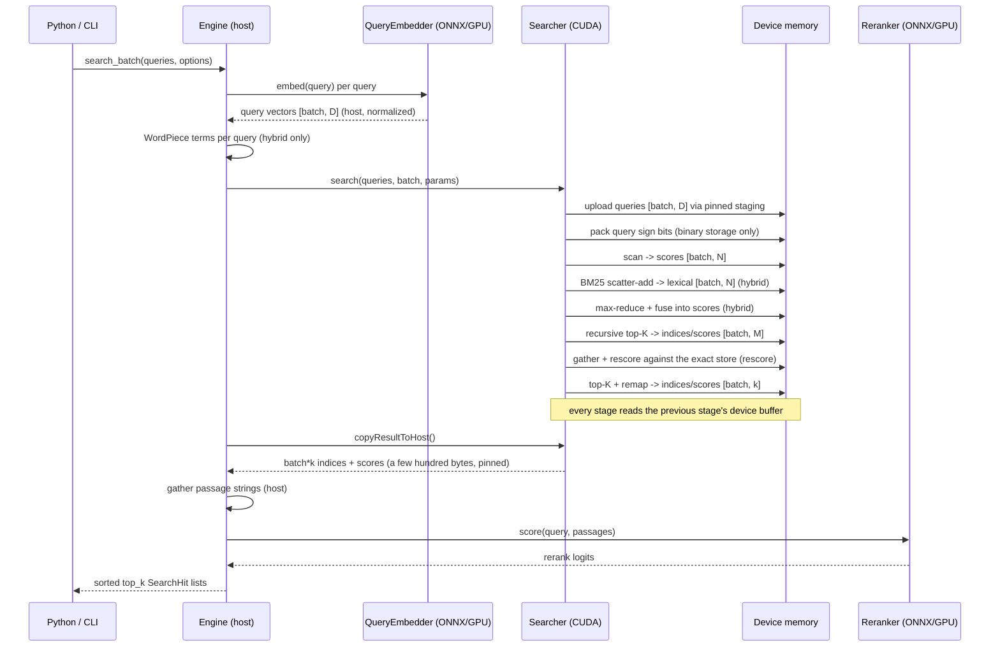

# Architecture

## Module responsibilities

| Module | Responsibility |
| --- | --- |
| `core` | CUDA RAII: typed device buffer, page-locked host buffer, stream, error→exception translation, device selection and properties. Nothing above this layer calls `cudaMalloc`/`cudaFree` directly. |
| `data` | The on-disk formats, the VRAM-resident embedding matrix (`EmbeddingStore`, four precisions), host-side corpus metadata (`Corpus`), and the device-resident CSR inverted index (`LexicalIndex`). |
| `cuda` | Host launchers and `__device__` primitives (`reduction.cuh`, `bitonic.cuh`, `decode.cuh`). The only files with kernels. Also the cuBLAS reference backend, which is a launcher of a different kind. |
| `search` | `Searcher` — owns every scratch buffer and the graph cache, and drives scan → fuse → select → rescore without leaving the device. `SearchParams` is its whole input surface. |
| `text` | `Tokenizer` — BERT uncased basic + WordPiece tokenization from `vocab.txt`. Serves both the ONNX models and the BM25 term lookup. |
| `onnx` | `OnnxSession` — RAII wrapper over an `Ort::Session` on the CUDA execution provider, plus typed run helpers. |
| `embed` | `QueryEmbedder` interface and its ONNX implementation (mean-pool + L2 normalize). |
| `rerank` | `Reranker` interface, its ONNX cross-encoder implementation, and the backend factory. |
| `engine` | `Engine` — composition root; owns the artifacts, resolves `SearchOptions` against `EngineConfig`, and assembles hits. |

The dependency direction is strictly downward:

```
engine → {embed, rerank, search, data, text} → {onnx, cuda, core}
```

Interfaces (`QueryEmbedder`, `Reranker`) keep the engine independent of ONNX Runtime, which is
why neither the engine nor the pybind layer includes an ONNX header.

## Data flow and device residency



`EmbeddingStore` holds a single `DeviceBuffer<uint8_t>` of `N · row_stride` bytes, allocated
once. `Searcher` allocates its scratch lazily and reuses it; buffers grow but never shrink, and
any growth bumps a generation counter that invalidates the graph cache.

## Why the batched scan has real arithmetic intensity

A single-query brute-force scan is the worst case for a GPU: one multiply-add per 4 bytes
loaded. No amount of kernel tuning fixes an algorithm that bandwidth-bound — you can only
approach the roofline, never exceed it.

Two levers actually move it, and the engine pulls both:

1. **Read fewer bytes.** The storage ladder cuts `row_stride` by 2×, 4× or 32×. This is the
   larger lever and it is why quantization is a first-class feature rather than an option.
2. **Reuse each byte.** Each resident block stages up to `kQueryTile = 8` queries in shared
   memory and uses every loaded corpus element eight times before discarding it. Intensity
   rises from ~1 to ~8 FLOP per element loaded, which moves the kernel off the bandwidth wall.

```cpp
// one warp per document, persistent over the corpus
for (int doc = blockIdx.x * warps + warp; doc < doc_count; doc += gridDim.x * warps) {
    for (int base = lane * kVec; base < dim; base += 32 * kVec) {
        float values[kVec];
        loadRow<Storage, kVec>(row + base, scale, values);   // one 128-bit global load
        #pragma unroll
        for (int q = 0; q < kQueryTile; ++q) {               // eight uses of each element
            if (q < tile) { /* float4 shared reads of query q, accumulate into partial[q] */ }
        }
    }
    // butterfly-reduce partial[q] across the warp; lane q stores query q's score
}
```

The `#pragma unroll` with a compile-time bound and a runtime `if (q < tile)` guard matters:
without it `partial[q]` is a runtime-indexed array and spills to local memory, which would
undo the whole optimization.

**Persistent, warp-per-document.** The grid is sized by
`cudaOccupancyMaxActiveBlocksPerMultiprocessor` to exactly fill the GPU, and each block's warps
then stride over the whole corpus. That is what makes query staging a one-off cost. The first
version of this kernel launched one block per document instead, and re-staged the 12 KB query
tile in every block — at 1M documents, ~12 GB of shared-memory fill traffic to scan a 0.05–1.5
GB corpus. It was correct, it passed every test, and it ran every storage precision at the same
speed (7–8 ms), because the fixed per-block cost dwarfed the corpus bytes. The rewrite runs at
87–94% of DRAM peak for all four precisions (`docs/BENCHMARKS.md`).

Rows are read in 128-bit transactions — `float4`, 8 × `half` or 16 × `int8` per lane — whenever
`dim` divides into 16-byte vectors and the store is 16-byte aligned; otherwise a scalar
instantiation of the same template runs. Binary rows (48 bytes at 384 dims) are too short to
split across a warp, so the Hamming kernel gives each *thread* a document and three `uint4`
loads.

The only `__syncthreads()` is before the document loop, so the masked-document `continue` and
the warp-shuffle reduction need only be *warp*-uniform, and they are: every lane of a warp is
on the same document.

## Top-K in recursive bitonic passes

A dot product is embarrassingly parallel. Selection is not: the answer depends on a global
ordering. The scheme keeps the work on-device and bounded:

```
scores [N] (device)
   │  local pass: ceil(N/1024) blocks × batch
   ▼
each block: load a 1024-element tile (pad -inf) → bitonic sort in shared mem → emit top-k
   │
   ▼
candidates [B·k] (scratch A)
   │  merge pass: ceil(C/4096) blocks × batch                       ◄────┐
   ▼                                                                     │ ping-pong A↔B
each block: load a 4096-element tile (pad -inf) → sort → emit top-k ──────┘
   │
   ▼  when one block remains
indices/scores [batch, k] (device)
```

The bitonic network sorts ascending; the largest `k` occupy the tail and are read out in
descending order. Padding with `-inf` and index `-1` means a pad entry can never displace a
real document as long as the corpus holds at least `k` of them.

**Why the merge tile is 4096 and not 1024.** Each merge pass turns `C` candidates into
`ceil(C/tile)·k`. Progress requires `tile > k`. With `k` capped at 1024 by the local tile, a
1024-element merge tile would make no progress at `k = 1024` and loop forever. A 4096-element
tile guarantees at least a 4× reduction per pass for every legal `k`, so the recursion always
terminates. The cost is 32 KB of shared memory per merge block, which is affordable precisely
because the merge is the low-parallelism stage anyway.

Why not sort the whole array? A full device sort is `O(N log²N)` compare-exchanges and
materializes a permutation that gets thrown away. Selecting per-tile first discards the vast
majority of candidates before the only serial step.

## The rescore stage, and why it is the interesting one

Binary quantization makes the scan 32× cheaper and measurably worse. The standard fix is to
re-score the survivors at full precision, and the standard *implementation* of that fix costs a
host round trip: copy candidate ids back, look them up, re-score, send the result on.

Here the top-K output buffer **is** the gather list:

```cpp
cuda::launchTopK(d_scores_, n, candidates, batch,
                 d_coarse_indices_, d_coarse_values_, /* scratch */ ..., stream);

cuda::launchGatherRescore(rescore_store_->deviceData(), rescore_store_->dtype(), ...,
                          d_coarse_indices_,   // ← written by the launch above
                          candidates, params.metric, d_rescored_, stream);

cuda::launchTopK(d_rescored_, candidates, params.k, batch,
                 d_local_indices_, d_out_values_, /* scratch */ ..., stream);

cuda::launchRemapIndices(d_coarse_indices_, d_local_indices_, candidates, params.k, batch,
                         d_out_indices_, stream);
```

Four launches on one stream, no synchronization, no transfer. The second top-K works in the
candidate set's own index space `[0, M)`, so the remap kernel translates those positions back
into corpus indices — one more reason the whole thing stays on the device.

This generalizes the project's original thesis. The first version removed one round trip
(the score vector). This removes a second one that only appears once you take quantization
seriously, and it is the transfer a naive quantized retrieval stack pays on *every query*.

## Hybrid retrieval on the device

The lexical stage is three kernels between the scan and the selection:

```
lexical [batch, N] ← 0
  bm25: one block per query term, threads stride its postings, atomicAdd into lexical
  max:  block-reduced fmaxf, then atomicMax on the bit pattern (valid: BM25 weights ≥ 0)
  fuse: dense[i] = w·dense[i] + (1-w)·lexical[i]/max
```

`atomicMax` on `__float_as_uint` is only monotonic for non-negative floats — which BM25 scores
are, by construction, since every posting weight is non-negative. That is a real precondition,
not an incidental one, and it is why the reduction is spelled `launchMaxPositive`.

Masked documents keep their `-FLT_MAX` dense score through fusion: the lexical term is bounded
by 1 after normalization, so a masked document can never be resurrected by a keyword match.

Query terms arrive as a flattened `[batch, lexical_stride]` array of WordPiece ids with `-1`
padding. The BM25 kernel skips `-1` slots, which keeps the launch shape constant across queries
of different lengths — that is what makes the hybrid path capturable into a CUDA graph
alongside everything else.

## CUDA graph caching

The pipeline is a fixed launch sequence for a given request shape, so it is captured once and
replayed. The subtlety is what "shape" means: a captured graph bakes in **every by-value kernel
argument and every pointer**. The cache key therefore carries all of them:

```cpp
struct GraphKey {
    const void* corpus;           // moves when add_documents reallocates
    const void* rescore_corpus;
    const void* lexical_index;
    const std::uint8_t* mask;     // changes when the allow-list changes
    std::uint64_t generation;     // bumped whenever any scratch buffer is reallocated
    std::int64_t doc_count;
    int k, batch, rescore_candidates, lexical_stride, metric;
    float dense_weight;           // a by-value kernel argument
};
```

A mismatch triggers recapture. Capture happens outside the CUDA event bracket so the reported
`search_gpu_ms` is pure replay, and it is wrapped so a capture failure ends the capture cleanly
rather than leaving the stream stuck in capture mode.

`stats().graph_captures` vs `graph_launches` is the diagnostic: if captures track launches,
something in the request shape is varying every query and you are paying capture cost instead
of saving launch cost.

Graphs cover the custom-kernel path only. Capturing cuBLAS calls is possible but depends on
handle workspace configuration, and the cuBLAS backend exists for benchmarking rather than for
production throughput, so it always launches directly.

## The Python/C++ boundary

`bindings/python/module.cpp` exposes `EngineConfig` and `SearchOptions` (mutable), `SearchHit`,
`Candidate`, `SearchTiming`, `SearchResponse`, `BatchSearchResponse` and `EngineStats`
(read-only), and `Engine`. Every search entry point runs under `py::gil_scoped_release`, so the
GIL is dropped for the CUDA and ONNX work and reacquired only to convert results into Python
objects. `std::vector<SearchHit>` and `std::vector<std::vector<SearchHit>>` convert
automatically via `pybind11/stl.h`.

Ownership across the boundary: the `Engine` is a single C++ object owned by Python. Everything
it allocates — the VRAM matrices, the inverted index, ONNX sessions, the CUDA stream, the graph
executable — is released by `~Engine()`, declared out-of-line so the `unique_ptr`s to
forward-declared `QueryEmbedder`/`Reranker` see complete types in the translation unit.

## Host memory that is not incidental

The one remaining device→host transfer goes through `PinnedBuffer<T>`. Copies out of pageable
memory are staged through a driver-owned bounce buffer and serialize against the stream;
page-locked memory lets the same copy run asynchronously and at full PCIe rate. It is a small
detail on a few-hundred-byte transfer, but it is the difference between "the last transfer is
small" and "the last transfer is small *and* does not stall the stream".

Query uploads use the same mechanism in the other direction.

## Binary formats

Three little-endian formats — the embedding matrix (`ZCVE`), corpus metadata (`ZCVM`) and the
lexical index (`ZCVL`) — specified byte by byte in [FORMATS.md](FORMATS.md).

The load-bearing design decision is that **document order is the index space**. The row index
in the embedding matrix, the value emitted by the top-K kernel, the doc index in a lexical
posting and the position in an allow-mask are all the same integer. That is what makes the
reranker's passage lookup a plain host array index by a device-selected candidate index, with
no offset table and no parsing on the query path.
