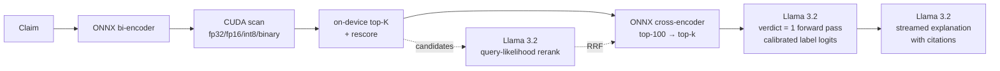

# Llama on top of the engine

The CUDA engine answers *which* abstracts matter in well under a millisecond. Meta's Llama 3.2
answers *what they say about the claim*. This document covers how the two are wired together,
the four jobs Llama does, how each one is measured, and what the measurements say — including
the parts that did not work.

Everything here runs on one 16 GB RTX 5060 Ti: the corpus index (2–8 MB), the ONNX encoder and
cross-encoder, and Llama-3.2-3B-Instruct in bf16 (6.4 GB) share the device.

```bash
bash scripts/download_llama.sh                         # Llama 3.2 3B + 1B, SciFact labels
bash scripts/run_factcheck.sh                          # one claim, end to end
CLAIM="Statins increase the risk of type 2 diabetes." bash scripts/run_factcheck.sh
python python/benchmarks/eval_llama.py --llama models/llama/Llama-3.2-3B-Instruct
```

## The pipeline



Retrieval is the engine exactly as documented in [ARCHITECTURE.md](ARCHITECTURE.md); only the
`k` hits that cross the device boundary are handed to Python. The Llama code is three files:

| File | What it holds |
| --- | --- |
| `python/zcgvs_tools/llama.py` | Model loading (gated-repo fallback), chat templating, streaming generation with TTFT and decode rate, `choice_logprobs`, `continuation_logprob` |
| `python/zcgvs_tools/factcheck.py` | `ClaimVerifier`, `LlamaReranker`, `GroundedAnswerer`, calibration |
| `python/benchmarks/eval_llama.py` | Every number on this page |

## Job 1 — the verdict is a classifier, not a parser

The obvious way to fact-check with an LLM is to ask for a verdict and parse the text. That is
slow (it must decode), brittle (it must be parsed) and gives no confidence. Instead
`ClaimVerifier` builds the prompt — claim plus the top-k retrieved abstracts — and runs **one
forward pass**. At the first answer position it reads the logits of the first token of each
label (`SUPPORT`, `CONTRADICT`, `NOT`), and renormalizes them into a probability distribution.

Two implementation details matter more than they look:

- **The LM head runs in float32, on three rows.** In bf16, logits around 20 are quantized to
  steps of 0.125. With three labels that is merely coarse; with the reranker's yes/no it tied
  most candidates and turned the ranking into noise. `choice_logprobs` takes the final hidden
  state and multiplies it by only the needed rows of `lm_head.weight`, upcast to fp32 — more
  exact *and* cheaper than computing the 128k-wide vocabulary.
- **Left padding.** Batched prompts are left-padded so the last real token of every row is at
  position `-1`, which is where both scoring and generation read.

### Calibration, fitted on train, frozen for test

Instruction-tuned models have strong label priors. Uncalibrated, Llama-3.2-1B never predicts
CONTRADICT on SciFact (F1 = 0.00). The fix is contextual calibration (Zhao et al., ICML 2021):
three additive offsets on the label log-probabilities. They are grid-searched for macro-F1 on
SciFact's **train** split — 809 claims that share no claims with the 300 evaluated — using the
same open-retrieval evidence, then frozen in `configs/calibration/<model>.json`.
`ClaimVerifier` loads the file for its model automatically.

### Results — 300 SciFact claims (= BEIR SciFact test)

*Open* evidence is what the engine retrieves (top-3 after the cross-encoder). *Oracle*
evidence is the abstracts the claim cites — an upper bound that isolates Llama's reasoning
from retrieval.

| Model | Evidence | Accuracy | Macro-F1 | SUPPORT F1 | CONTRADICT F1 | NEI F1 |
| --- | --- | ---: | ---: | ---: | ---: | ---: |
| majority class | — | 0.413 | 0.195 | 0.585 | 0.000 | 0.000 |
| Llama-3.2-1B | retrieved, raw | 0.377 | 0.262 | 0.506 | 0.000 | 0.280 |
| Llama-3.2-1B | retrieved, calibrated | 0.383 | 0.385 | 0.414 | 0.411 | 0.330 |
| Llama-3.2-1B | cited (oracle), raw | 0.430 | 0.260 | 0.582 | 0.000 | 0.199 |
| Llama-3.2-1B | cited (oracle), calibrated | 0.337 | 0.297 | 0.486 | 0.311 | 0.094 |
| Llama-3.2-3B | retrieved, raw | 0.527 | 0.431 | 0.525 | 0.156 | 0.612 |
| Llama-3.2-3B | retrieved, calibrated | **0.550** | **0.514** | 0.655 | 0.315 | 0.571 |
| Llama-3.2-3B | cited (oracle), raw | 0.657 | 0.598 | 0.676 | 0.391 | 0.726 |
| Llama-3.2-3B | cited (oracle), calibrated | 0.647 | 0.613 | 0.742 | 0.424 | 0.673 |

What the table says:

- **Scale matters most.** With retrieved evidence and calibration, the 3B model reaches
  macro-F1 0.514 against 0.385 for the 1B and 0.195 for always answering SUPPORT.
- **Calibration is worth +0.083 macro-F1 for free** on the 3B, and it transfers: fitted on
  train it scored 0.509 there and 0.514 on the held-out claims. For the 1B it is the difference
  between never predicting CONTRADICT (F1 0.00) and predicting it usefully (F1 0.41).
- **Retrieval vs reasoning.** Handing the 3B the abstracts the claim actually cites lifts
  macro-F1 to 0.613. The gap to 0.514 is what retrieval errors cost; the rest is the 3B model's
  reasoning, and the task itself. CONTRADICT is the hard class in both settings — refutations
  in abstracts are usually implicit (a null result, a different population), not a negation of
  the claim's words.
- The calibration offsets were fitted on open-retrieval evidence, so applying them to oracle
  evidence is a distribution shift. Macro-F1 still rises for both models (3B 0.598 → 0.613, 1B
  0.260 → 0.297), but accuracy falls (3B 0.657 → 0.647, 1B 0.430 → 0.337): calibration trades
  majority-class hits for minority-class recall, which is what macro-F1 rewards.

## Job 2 — the explanation is generated after the verdict

Once the label is fixed, the verdict is appended to the conversation as the assistant's turn
and Llama is asked to justify it in two or three sentences, supporting it with one or two
**exact quotations**, each in double quotes and followed by the number of the abstract it came
from, like `"..." [2]`. The explanation streams token by token (`TextIteratorStreamer` on a
worker thread), so the user sees the verdict and its confidence bars immediately and the
reasoning as it is written.

Conditioning the explanation on the classifier's label keeps the two consistent. The cost is
that the explanation can rationalize a wrong verdict — which is why the verdict carries a
calibrated probability and the evidence is always shown alongside it.

### The quote checker

A 3B model asked to explain itself sometimes misquotes. In an early version of the demo, the
explanation credited an abstract with an "improvement" finding that it did not contain, cited a
page number that abstracts do not have, and turned "adenomas in 17% of aspirin patients *versus
27% on placebo*" into "a 17% lower incidence". Rather than hide that, the prompt now asks for
verbatim quotations and `check_quotes` verifies each one mechanically:

- a quote is **verified** if its words appear verbatim in a retrieved abstract (case, spacing and
  edge punctuation aside; a quote with `...` is checked fragment by fragment) **and**, when the
  model wrote a citation `[n]` immediately after it, in *that* abstract (a citation placed before
  the quote, as in "abstract [2] states that ...", is not read, so only the words are checked);
- otherwise it is **not found verbatim** (invented, or a paraphrase dressed as a quote) or
  **misattributed** (real words, wrong abstract);
- the demo prints every check, `/verify` returns them as `quote_checks`, and
  `Verdict.quotes_verified` is true only if there is at least one quote and all of them pass.

Audit — Llama-3.2-3B, explanations for the first 100 SciFact dev claims
(`python python/benchmarks/eval_llama.py --tasks grounding`):

| | Count |
| --- | ---: |
| Explanations containing a quotation | 86 of 100 |
| Quotations produced | 137 |
| **Verified verbatim, in the cited abstract** | **121 (88%)** |
| Not found verbatim in any retrieved abstract | 13 |
| Real words, wrong abstract cited | 3 |
| Explanations in which *every* quotation verified | 70 of 100 |

The results file keeps the first 8 of the 16 failures (`examples_of_failures`). They are a mix
of near-misses (a word changed or dropped inside the quotation marks), misattributions (real
words, wrong abstract number), and genuine hallucination — in one case the model quoted the
*claim's own sentence* as if it were evidence from an abstract. The checker flags all of them.

The checker is strict on purpose. In one run the model quoted "...(beta = -0.11; 95% CI, -0.18 to
-0.04; P = 0.002)" where the abstract says "95% confidence interval [CI]". The numbers are
right and the quote is flagged anyway, because a quotation mark promises verbatim text.

What it does **not** do: it does not check paraphrases, and a verbatim quote can still be
used to support the wrong conclusion. The checker is a tripwire for fabricated evidence, not a
proof of correct reasoning — which is why the abstracts are always printed beside the verdict.

## Job 3 — Llama as a zero-shot reranker

`LlamaReranker` implements two scoring rules over the same candidates:

- **`yes_no`** — "Is this abstract direct evidence about the query? Reply Yes or No", scored
  as `log P(Yes) − log P(No)`.
- **`query_likelihood`** — UPR (Sachan et al., EMNLP 2022). Show Llama the *abstract*, ask it
  to write a claim the abstract is evidence about, and score how probable it finds the *actual*
  claim: the mean token log-probability, teacher-forced in one forward pass per batch
  (`Llama.continuation_logprob`). Only the claim positions go through the LM head.

Candidates are the engine's top-20 dense hits and the cross-encoder's top-20, scored once and
reused across every system below. nDCG@10 and Recall@10 over all 300 queries; the last column
is a paired bootstrap (10 000 resamples of the queries) against the cross-encoder alone:

| System | nDCG@10 | Recall@10 | vs cross-encoder |
| --- | ---: | ---: | --- |
| Dense scan only (MiniLM bi-encoder) | 0.6494 | 0.7917 | -0.0314 [-0.0628, -0.0010], significant |
| ONNX cross-encoder (ms-marco-MiniLM-L6) | 0.6807 | 0.7982 | — |
| Llama yes/no judge — 1B | 0.2530 | 0.5613 | -0.4278 [-0.4720, -0.3835], significant |
| Llama yes/no judge — 3B | 0.6331 | 0.7773 | -0.0476 [-0.0839, -0.0119], significant |
| cross-encoder top-10 → Llama yes/no — 1B | 0.3953 | 0.7982 | -0.2854 [-0.3184, -0.2515], significant |
| cross-encoder top-10 → Llama yes/no — 3B | 0.6549 | 0.7982 | -0.0259 [-0.0520, +0.0004], not significant |
| RRF(cross-encoder, Llama yes/no) — 1B | 0.5130 | 0.7897 | -0.1677 [-0.2003, -0.1356], significant |
| RRF(cross-encoder, Llama yes/no) — 3B | 0.6868 | 0.8139 | +0.0060 [-0.0138, +0.0256], not significant |
| Llama query likelihood — 1B | 0.6560 | 0.7779 | -0.0248 [-0.0609, +0.0106], not significant |
| Llama query likelihood — 3B | 0.5742 | 0.7260 | -0.1065 [-0.1473, -0.0662], significant |
| cross-encoder top-10 → Llama query likelihood — 1B | 0.6827 | 0.7982 | +0.0019 [-0.0216, +0.0261], not significant |
| cross-encoder top-10 → Llama query likelihood — 3B | 0.6271 | 0.7982 | -0.0537 [-0.0853, -0.0230], significant |
| RRF(cross-encoder, Llama query likelihood) — 1B | **0.6976** | 0.8056 | +0.0169 [-0.0023, +0.0363], not significant |
| RRF(cross-encoder, Llama query likelihood) — 3B | 0.6702 | 0.8157 | -0.0105 [-0.0359, +0.0139], not significant |

What the table says — and it is not the story I expected to write:

- **No zero-shot Llama reranker beats the trained cross-encoder on its own.** Every Llama-only
  row is below it, and all but 1B query likelihood significantly so. MiniLM-L6 was trained for
  exactly this on MS MARCO passage ranking; a zero-shot 1–3B generalist does not overturn that.
- **The two scoring rules scale in opposite directions.** The yes/no judge at 1B scrambles the
  dense ranking it is given (0.2530, against 0.6494 for that ranking untouched) and becomes a
  usable signal at 3B (0.6331). Query likelihood does the reverse: 0.6560 at 1B, 0.5742 at 3B. My best guess is
  that the more strongly instruction-tuned 3B writes claims in its own style rather than the
  dataset's, which query likelihood punishes — but that is a hypothesis, not a measurement.
- **Fusion is where Llama earns its place.** Reciprocal-rank fusion with the cross-encoder
  gives the best system measured: 1B query likelihood + cross-encoder at **0.6976**, better on
  46 queries and worse on 34. The paired bootstrap interval, [−0.0023, +0.0363], still crosses
  zero, so this is a promising +0.017, not a proven one; 300 queries cannot resolve a gain this
  size.
- **Cost.** Llama scores 41 (1B) or 15 (3B) query–abstract pairs per second on this GPU in
  bf16, against the cross-encoder's 100 pairs in ~74 ms. Llama reranking is an opt-in quality
  knob, not the default path.

## Job 4 — grounded question answering

`GroundedAnswerer` retrieves the top-5 abstracts and asks Llama to answer **only** from them,
citing each sentence as `[n]` and saying so when the sources are insufficient. It is the same
retrieval path with a generation prompt; it is exposed as `--ask` in the demo and `POST /ask`
in the service.

Unlike the other three jobs, **this one is a demonstration, not a benchmarked result**: there is
no labelled question set behind it, and its output is not quote-checked. Model size matters
visibly. Asked "What causes beta cell failure in type 2 diabetes?", the 3B model writes a hedged
paragraph that cites sources [1] and [3]; the 1B model mostly restates the five abstracts, garbles
one of them, and concludes the sources "do not provide a clear answer". Use the 3B model.

## Latency

Median of 20 claims after warmup, full `verify` with explanation, Llama-3.2-3B in bf16:

| Stage | ms |
| --- | ---: |
| query embedding (ONNX, host-visible) | 1.18 |
| **CUDA scan + top-K** (CUDA events) | 0.08 |
| device → host, k results (pinned) | 0.08 |
| cross-encoder rerank, 100 candidates | 77.02 |
| **Llama verdict** — one forward pass | 153.29 |
| Llama explanation, first token | 159.25 |
| Llama explanation, complete | 2519.51 |
| **end to end**, with explanation | 2785.57 |
| decode rate | 49 tokens/s |

The CUDA scan and the device→host copy together are a rounding error next to either model.
That is the honest headline: the retrieval engine makes the *search* free, which leaves the
whole latency budget to the models that actually need it.

## Using it

```python
from zcgvs_tools.config import build_engine
from zcgvs_tools.factcheck import ClaimVerifier, GroundedAnswerer, LlamaReranker
from zcgvs_tools.llama import Llama

engine = build_engine("configs/scifact.json")
llama = Llama("meta-llama/Llama-3.2-3B-Instruct")      # or a local directory

verdict = ClaimVerifier(engine, llama).verify(
    "Vitamin D supplementation prevents fractures in older adults.",
    on_text=lambda piece: print(piece, end="", flush=True),
)
print(verdict.label, verdict.probabilities, [e.doc_id for e in verdict.evidence])

generation, sources, timing = GroundedAnswerer(engine, llama).answer(
    "What links obesity to insulin resistance?")
```

HTTP, with the service started as
`python -m zcgvs_tools.service --config configs/scifact.json --llama models/llama/Llama-3.2-3B-Instruct`:

```bash
curl -s localhost:8000/verify -H 'content-type: application/json' \
     -d '{"claim": "Aspirin reduces colorectal cancer risk."}' | jq '.verdict, .probabilities'
curl -s localhost:8000/ask -H 'content-type: application/json' \
     -d '{"question": "What causes beta cell failure in type 2 diabetes?"}' | jq -r .answer
```

## Model access

The official `meta-llama/*` repositories are gated. `Llama()` and `download_llama.sh` try them
first; if the Hugging Face token has not been granted access they fall back to the
byte-identical `unsloth/*` mirror of the same release, which the Llama 3.2 Community License
permits. Request access on the model page to use the official repo directly. Use of the
models is governed by the [Llama 3.2 Community License](https://www.llama.com/llama3_2/license/)
and Acceptable Use Policy.

## Limitations

- **Small models, honest numbers.** 1B and 3B are what fit beside the index on a 16 GB card
  in bf16. Llama-3.1-8B in bf16 needs 16 GB on its own; it would need 8-bit weights here.
- **Claim-level labels.** The verifier labels the claim against all top-k abstracts at once.
  SciFact's official task also labels each abstract and selects rationale sentences; this does
  neither.
- **Calibration is per model and per evidence setting.** The offsets were fitted with open
  retrieval evidence; applied to oracle evidence they are a distribution shift, which shows in
  the oracle rows.
- **English biomedical abstracts.** Prompts and calibration are tuned to SciFact only.
