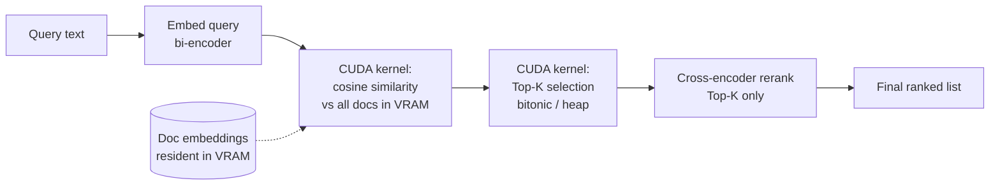

# Project 1 — Zero-Copy GPU Vector Search & Re-Ranking Engine

**One line:** A C++/CUDA library that holds document embeddings in VRAM, does Top-K similarity search with a hand-written CUDA kernel, reranks the survivors with a cross-encoder, and never round-trips the candidate set back to CPU in between — exposed to Python via `pybind11`.

**Why this one is the anchor of the four:** the hard kernel here (a parallel Top-K / bitonic selection) is genuinely harder than the matmul kernel everyone writes, and the "keep it in VRAM, don't serialize back to host" framing is a real systems instinct that separates this from a FAISS tutorial. Start here.

---

## What it actually does (the pipeline)

The whole point: steps S → T → R happen on the GPU with the candidate indices staying in device memory. A naive RAG stack copies the Top-K back to CPU, then ships them to the reranker, then back to GPU. You're deleting those transfers.

**Scope discipline:** this is *exact* search (brute-force cosine over everything in memory), not an approximate index like HNSW. That's deliberate — a correct brute-force GPU search that beats a CPU baseline is a clean, finishable artifact. Approximate indexing is a different (much larger) project; don't scope-creep into it.

---

## What to learn, in order

You're already doing CUDA fundamentals (freeCodeCamp + PMPP). Map it to this project:

1. **Reductions and memory coalescing** — the cosine-similarity kernel is a batched dot-product, which is a reduction. This is PMPP Ch. 10 (reduction) and the coalescing material in Ch. 5–6. Get the reduction pattern solid before anything else. Book: *Programming Massively Parallel Processors*, 4th ed. (Hwu, Kirk, El Hajj). Community notes + solution code: https://github.com/tugot17/pmpp and https://github.com/loganwatchorn/notes-pmpp
2. **Bitonic sort / parallel Top-K** — the selection step. This is the part worth real study time. Readable CUDA walkthrough: https://people.cs.rutgers.edu/~venugopa/parallel_summer2012/cuda_bitonic.html . The idea that bitonic sequences give you Top-K in log(k) steps (not a full sort) is the key trick — paper: "Efficient Top-K Query Processing on Massively Parallel Hardware" (Shanbhag et al., SIGMOD 2018), https://www.doc.ic.ac.uk/~hlgr/pdfs/MassivelyParallelTopK.pdf . For a portfolio version, a per-block heap or a partial bitonic sort is enough; you don't need a state-of-the-art radix top-k.
3. **pybind11** — the Python boundary. Docs: https://pybind11.readthedocs.io . You only need the basics: expose a class, pass NumPy arrays in/out (`py::array_t`), return a list. Half a day of reading.
4. **`torch::from_blob` / LibTorch tensor basics** — only for feeding data into the reranker. See the "reranker" note below on *how* you run it (this is where a 2026 gotcha lives).

---

## Models, datasets, libraries — all links

**Reranker (cross-encoder):** `cross-encoder/ms-marco-MiniLM-L6-v2`
- https://huggingface.co/cross-encoder/ms-marco-MiniLM-L6-v2
- ~80MB, tiny, purpose-built for exactly this "score (query, passage) pairs and rerank" task. Trained on MS MARCO passage ranking.

**Bi-encoder (to generate the doc + query embeddings):** `sentence-transformers/all-MiniLM-L6-v2`
- https://huggingface.co/sentence-transformers/all-MiniLM-L6-v2
- Outputs 384-dim embeddings. You embed the whole corpus *once* (offline, in Python), save the vectors to disk, and load them into VRAM at startup. Query embedding happens per-request.

**Dataset (the document corpus):** BEIR — use a small subset first
- SciFact (~5.2k docs): https://huggingface.co/datasets/BeIR/scifact
- NFCorpus (~3.6k docs): https://huggingface.co/datasets/BeIR/nfcorpus
- BEIR toolkit + direct download links: https://github.com/beir-cellar/beir
- Format is uniform across BEIR: `corpus` (id, title, text), `queries`, `qrels` (ground-truth relevance). SciFact/NFCorpus are small enough to hold entirely in 16GB with room to spare, and the `qrels` give you a correctness check (does your GPU search return the known-relevant docs?).

**Libraries:**
- LibTorch (PyTorch C++): https://pytorch.org/get-started/locally/ (select LibTorch + CUDA)
- pybind11: https://github.com/pybind/pybind11
- CMake (build system tying CUDA + LibTorch + pybind11 together)

---

## The 2026 gotcha you need to know before you start

The obvious way to run the cross-encoder in C++ is "export to TorchScript, load with LibTorch." **TorchScript is deprecated as of PyTorch 2.10.** It still works and still loads — Ultralytics and others keep it alive for "legacy C++ compatibility" — but for a portfolio piece in 2026 you want to know you're on a deprecated path and be able to say why.

Two clean options for the reranker step:
- **(a) ONNX Runtime (C++):** export the cross-encoder to ONNX (`optimum` does this in one line), run it with ONNX Runtime's C++ API with the CUDA execution provider. This is the more future-proof choice and ONNX is the vendor-neutral standard. The cross-encoder already has ONNX weights on the Hub.
- **(b) LibTorch + TorchScript:** the path the shared doc assumed. Fine for a demo, just say in your README that you know it's deprecated and ONNX is the modern route.

Either is legitimate. Pick (a) if you want the stronger 2026 story; pick (b) if you'd rather not add ONNX Runtime to the build. Your custom CUDA kernels (similarity + Top-K) are unaffected either way — they're the real content.

---

## Build sequence (≈3 weeks, relaxed)

**Week 1 — get the pieces working in isolation.**
- Embed a BEIR corpus subset in Python, dump embeddings to a `.npy` / raw binary.
- C++ program that loads the embeddings into VRAM (`cudaMalloc` + `cudaMemcpy`).
- Naive CUDA cosine-similarity kernel: one thread block per query, reduction over the embedding dim. Correctness-check against a NumPy cosine on CPU.

**Week 2 — the hard kernel.**
- Top-K selection kernel (start with a simple per-block partial sort or heap; optimize to bitonic if time allows). Correctness-check: do the Top-K indices match a `np.argsort` reference?
- Wire similarity → Top-K so the indices never leave the device between them.

**Week 3 — reranker + Python boundary.**
- Load the cross-encoder (ONNX-RT or LibTorch per your choice). Feed it the Top-K passages, get scores, produce the final order.
- `pybind11` wrapper: `import my_engine; eng = my_engine.Engine("corpus.bin"); eng.search("my query", k=10)`.
- One benchmark: end-to-end query latency vs. a pure-Python baseline (sentence-transformers `util.semantic_search` + CrossEncoder). Report the number honestly (warm-up runs, median of many).

---

## Definition of done

- [ ] Loads a real BEIR corpus into VRAM and answers text queries end-to-end
- [ ] Similarity + Top-K are your own CUDA kernels, correctness-checked against NumPy references
- [ ] Candidate indices demonstrably stay on-device between search and rerank (say so, show it in code)
- [ ] `import` works from Python via pybind11
- [ ] README: architecture diagram, the zero-copy claim explained, the reranker-runtime choice (and the TorchScript-deprecation note), and one honest latency comparison

## What makes it an interview signal

You can talk about: reductions and coalescing, why Top-K selection is harder to parallelize than a dot-product, the cost of host↔device transfers in a real ML pipeline, and the Python/C++ ABI boundary. Those are four distinct MLSys conversation threads from one repo. Keep the claims measured — "here's the transfer I removed and here's the measured effect" beats "10x faster."
